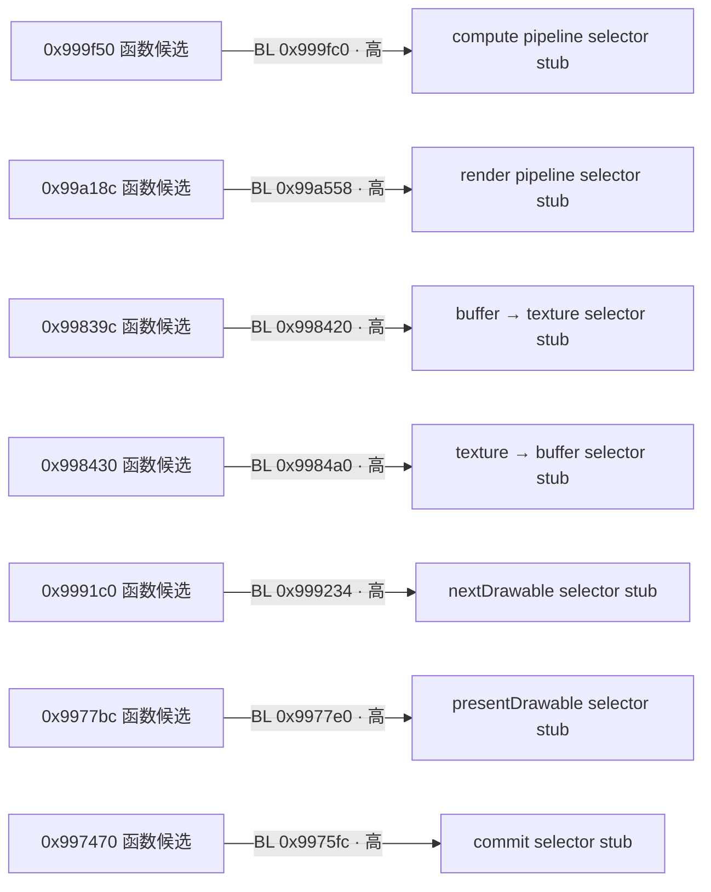

# Adobe Camera Raw 17.2：第一阶段静态处理管线分析

日期：2026-10-12（Asia/Shanghai）。目标只读；未启动 Adobe 宿主、修改 Adobe 文件、patch 或写入原二进制。

## 交付状态

Hopper 初始分析曾推进到 pass 10/11，随后弹出 `Demo period has expired. Document will be closed.`。没有点击 OK，没有在该限制出现后重新连接、终止进程或清理会话。用户选择先交付当前报告。因此本阶段为**部分完成**：安装枚举、静态字节/imports、历史 GPU 日志与局部反汇编已取得；Hopper 完整伪代码、最终函数目录与分析数据库保存未完成。`research/acr/benchmarks/` 已建立，`.hop` 被局部忽略，但目前没有成功保存的数据库。

## 当前结论与证据口径

安装包含一个 universal Mach-O，版本 17.2 (2155)，有 x86_64 与 arm64 两个切片。本阶段函数地址使用 arm64 的静态 VM 地址（未加 ASLR slide），不能用于 x86_64。主文件 SHA-256：`c0d0bdad561b3e2948b21b6a4b8a267a86ad4f4f2d99b890632dcaa88f431234`。

主插件：`/Library/Application Support/Adobe/Plug-Ins/CC/File Formats/Camera Raw.plugin`。

主 Mach-O：`/Library/Application Support/Adobe/Plug-Ins/CC/File Formats/Camera Raw.plugin/Contents/MacOS/Camera Raw`。下文未另写路径的函数、字符串、selector 均位于此文件。

证据分三层：①文件字节、imports、Hopper 反汇编/xref 是静态观察；②已有日志是那个历史会话的运行记录；③候选管线连线是推断。静态调用不证明当前执行，日志初始化成功也不证明所有图像操作使用 GPU。字符串名称不是恢复出的源代码函数名。

## 安装枚举与原生组件

完整清单见 [安装盘点](2026-10-12-install-inventory.md) 和 [inventory.json](evidence/inventory.json)。插件树枚举 138 个普通文件、0 个 symlink，唯一原生二进制是 `Contents/MacOS/Camera Raw`（290,177,856 bytes）。`Contents/Frameworks` 为空，没有嵌套 framework、dylib、bundle、helper、app 或 XPC。没有独立 TicoRAW 动态库不等于没有内嵌解码器。

REA `inspect_macho` 成功，Evidence ID：`ev_65b7a0b4a547733e9270a96f90ff7d2b3246597e4a39bfa399316cc8c9be6aa5`，保存在 [REA evidence bundle](evidence/rea-phase1.json)。arm64 slice full-file offset `150716416`（`0x8fbc000`），size `139461440`；x86_64 offset `16384`，size `150696704`。arm64 `LC_SYMTAB` 仅 1 个 local、2 个 external defined、1030 个 undefined，不能依赖导出符号恢复内部 C++ 处理链。

直接依赖包括 Metal、QuartzCore、ColorSync、CoreGraphics、Accelerate、CoreML，也包括 OpenGL。这证明多个后端/功能所需的 API 被链接，不能单凭 `cr_opengl_*` 名称断言本机使用 OpenGL。

## RAW、Nikon 与 TicoRAW 候选

| 观察 | arm64 字符串地址 | 支持的结论 | 置信度与边界 |
|---|---|---|---|
| `ReadNikonCompressed_Scalar` | `0x79b21b1` | 有 Nikon 压缩读取的 scalar 路径线索 | 高：字符串存在；实际分支和算法待核对 |
| `cr_read_nikon.cpp` build basename、Nikon distortion/CA 错误 | `0x79b2081` 起邻近区 | Nikon 私有处理还包含几何/镜头信息 | 中：不能把所有 Nikon 路径都归入 RAW 解压 |
| `ipxcpucodec_init_ctx_options failed` | `0x79b1f68` | 有 CPU codec 上下文初始化错误路径 | 高：字节观察；codec 品牌未知 |
| `ipxcpucodec_init_decoder failed` | `0x79b1fb0` | 有 decoder 初始化错误路径 | 高：字节观察 |
| `ipxcpucodec_init_image_geometry failed` | `0x79b1fd0` | codec 接收图像几何配置 | 中：需要调用点参数核对 |
| `ipxcpucodec_init_image_format_cfg failed` | `0x79b1ff7` | codec 接收图像格式配置 | 中 |
| `ipxcpucodec_init_decode_options failed` | `0x79b2020` | codec 接收解码选项 | 中 |
| `ipxcpucodec_decode_default_callback_begin_write_output_stripe` | `0x79b4d28` | 有分条写入输出的 callback 名称 | 中：名称不能证明该 callback 的完整实现 |

`TicoRAW`、`High Efficiency` 的 ASCII 搜索未得到明确命中；`HE`/`HE*` 的大量短命中包含指令/压缩数据偶然字符，不能作为格式证据。搜索覆盖文件内长度至少 5 的可打印 ASCII 序列，未覆盖所有 UTF-16、压缩资源或无名函数。因此不能得出“不支持 HE/HE*”的结论。`ipxcpucodec_*` 是值得继续追踪的 codec 候选；目前不将其正式认定为 TicoRAW，也没有证明 Nikon HE/HE* 分支调用它。

字节证据：[arm64 strings](evidence/main-arm64-strings.json)、[codec strings](evidence/main-codec-strings.json)。完整原始文件 offset 与 VM 坐标分开记录；源码构建路径中个人路径已脱敏。

## 去马赛克与色彩处理

| 字符串/RTTI | arm64 VM 地址 | 分析意义 |
|---|---|---|
| `standard bayer demosaic` | `0x79414cd` | 标准 Bayer demosaic 路径候选 |
| `33cr_stage_cnn_bayer_naive_demosaic` | `0x3141db1` | CNN Bayer stage 类型线索，不能当作默认 RAW 路径 |
| `LoadBayerDemosaicModels` | `0x7939ae7` | Bayer 模型加载入口线索 |
| `LoadXTransDemosaicModels` | `0x7939b06` | X-Trans 模型加载入口线索 |
| `18dng_camera_profile` | `0x7784dd0` | DNG camera profile 对象 |
| `17cr_camera_profile` | `0x3141680` | ACR camera profile 对象 |
| `Stage1-ColorTransform` | `0x7967f28` | Stage1 色彩变换的诊断/计时标签 |
| `BuildNegative-ColorTransform` | `0x7982abd` | 构建 negative 的色彩变换标签 |
| `InitializeGPUDisplayColorTransforms` | `0x78baec3` | GPU 显示色彩变换初始化标签 |

文件包含 `.dcp` 格式 profile 的 UI 文案、CameraProfiles 资源查找及 DNG profile 类型。DCP/camera profile 的证据与显示 ICC 的证据要分开：`_CGColorSpaceCopyICCProfile`、`_CGColorSpaceCreateWithName`、`_ColorSyncIterateInstalledProfiles` 是显示/系统 profile 的 import，不能代替 DCP 色彩矩阵、HueSatMap 或 LookTable 的调用证据。`cr_opengl_color_transform` 类型名与 LUT/texture 名称表明 GPU 色彩变换抽象，具体 Metal 后端调用关系另列。

## GPU 配置、日志与 Metal

GPU 配置路径：`/Users/hualaiwu/Library/Application Support/Adobe/CameraRaw/GPU/Adobe Photoshop Camera Raw/Camera Raw GPU Config.txt`；另有 Lightroom Classic 的 GPU Config。两份记录 `gpu_compute_quick_self_test_passed=True`，`gpu_preferred_system` 为空，所以不能只用配置字段选择 Metal。

最新日志路径：`/Users/hualaiwu/Library/Application Support/Adobe/CameraRaw/Logs/Camera Raw Log Latest v1.txt`，mtime 2026-10-11 20:22:57 +08:00；v0 文件 mtime 20:22:37。v1 记录 `Loaded GPU system: Metal`、Apple M2 Pro、1 个设备、GPU3/GPU4 hard/soft 最终 success、257/257 compute pipeline states 完成。v0 记录 ACR SDK 17.2x2155。支持“该记录会话成功初始化 Metal”，不支持“当前正在运行”或“RAW 解压都在 GPU”。共享辅助目录没有对应 GPU Config/Latest 日志。详见安装盘点与其脱敏字段证据。

主文件 imports：`_MTLCopyAllDevices`、`_MTLCreateSystemDefaultDevice`、`_OBJC_CLASS_$_CAMetalLayer`、`MTLComputePipelineDescriptor`、`MTLRenderPipelineDescriptor`、`MTLTextureDescriptor`。RTTI 包括 `cr_metal_device`、`cr_metal_command_queue`、`cr_metal_command_buffer`、`cr_metal_texture`、`cr_metal_compute_pass`、`cr_metal_render_pass`、`cr_metal_swap_chain`。这是 Metal 后端存在的高置信度静态证据。

### Metal selector 与输入输出边界

以下地址由 `__objc_methname` 和 `__objc_selrefs` 的字节解析得到，是元数据引用，尚不能直接称为函数调用。完整表：[metal-selectors.json](evidence/metal-selectors.json)。

| 功能 | selector | selref VM |
|---|---|---|
| 计算 pipeline 创建 | `newComputePipelineStateWithDescriptor:options:reflection:error:` | `0x811cc68` |
| 渲染 pipeline 创建 | `newRenderPipelineStateWithDescriptor:error:` | `0x811cc88` |
| shader library | `newLibraryWithData:error:` / `newFunctionWithName:` | `0x811cc80` / `0x811cc78` |
| texture 创建 | `newTextureWithDescriptor:` | `0x811cc98` |
| compute texture 绑定 | `setTexture:atIndex:` | `0x811d5f0` |
| fragment texture 绑定 | `setFragmentTexture:atIndex:` | `0x811d2a8` |
| buffer → texture | `copyFromBuffer:…:toTexture:…` | `0x811c480` |
| texture → buffer | `copyFromTexture:…:toBuffer:…` | `0x811c490` |
| compute dispatch | `dispatchThreadgroups:threadsPerThreadgroup:` | `0x811c5e8` |
| 获取 drawable | `nextDrawable` | `0x811cca0` |
| 预览呈现候选 | `presentDrawable:` | `0x811ce50` |
| 提交 command buffer | `commit` | `0x811c3c8` |

输入 texture、输出 texture 的具体绑定槽位、像素格式、读写权限及 shader 函数尚不能从 selector 表得到；这些需要查看调用点参数和数据流。compute 与 display render 是两条可协作的 API 链，不能把存在两类 pipeline 自动解释为每次预览都按同一顺序执行。

## 候选图

### 已核对的 Metal 局部静态调用

`__objc_selrefs` 的 8-byte 指针与 selector 字符串地址一致；`__objc_stubs` 的 ADRP/LDR 装载该 selector；`__text` 的 BL imm26 目标指向对应 stub。7 组局部 llvm-objdump 片段另核对了以下 9 个调用位置。这是**已证实的静态 BL→selector stub 边**；receiver 身份、运行时动态派发、shader 内容和实际执行仍未观测。函数列用 LC_FUNCTION_STARTS 候选地址命名，不冒充恢复出的原始方法名。

| 函数开始候选 | 直接 BL 位置 | selector stub | selector / 角色 |
|---|---|---|---|
| `0x99a9bc` | `0x99aaa4` | `0x1e853e0` | `newLibraryWithData:error:` |
| `0x999f50` | `0x999fc0` | `0x1e85380` | compute pipeline 创建 |
| `0x99a18c` | `0x99a558` | `0x1e85400` | render pipeline 创建 |
| `0x9998ac` | `0x999a80` | `0x1e85440` | texture 创建 |
| `0x99839c` | `0x998420` | `0x1e833e0` | buffer → texture 复制 |
| `0x998430` | `0x9984a0` | `0x1e83420` | texture → buffer 复制 |
| `0x9991c0` | `0x999234` | `0x1e85460` | `nextDrawable` |
| `0x9977bc` | `0x9977e0` | `0x1e85b20` | `presentDrawable:` |
| `0x997470` | `0x9975fc` | `0x1e83100` | `commit` |

`setTexture:atIndex:` 和 `setFragmentTexture:atIndex:` 有 selref 与 stub，但本轮限定于 `__text` 直接 BL 到 stub 的搜索没有命中；这不排除尾调用 B、间接调用或其他路径。本轮没有证明上述独立包装器的调用者把某个 compute 输出纹理接到同一预览帧。**pipeline 创建、纹理上传/下载和 drawable 提交各自的局部边已建立，连接它们的完整调用关系仍为候选。**

图中的方框是已观察到的对象/API/标签；虚线连线表示候选先后关系，实线仅用于经过反汇编核对的局部调用（后续证据段补充）。

```mermaid
flowchart LR
    RAW["RAW / NEF 输入"] -. "RAW 解码链 · 中" .-> READ["格式分派 / 压缩读取候选"]
    READ -. "Nikon 分支 · 中" .-> NIK["ReadNikonCompressed_Scalar"]
    READ -. "TicoRAW / HE / HE* · 未验证" .-> IPX["ipxcpucodec CPU codec 候选"]
    NIK -. "CFA 输出 · 未验证连接" .-> CFA["线性化 / CFA"]
    IPX -. "是否 Nikon HE 调用 · 未验证" .-> CFA
    CFA -. "标准 RAW 路径 · 中" .-> DEM["standard bayer demosaic"]
    CFA -. "增强分支 · 中" .-> CNN["Bayer / X-Trans CNN 模型与 stage"]
    DEM -. "色彩处理链 · 中" .-> COL["camera profile / DCP / ColorTransform"]
    CNN -. "输出接入点未知" .-> COL
    COL -. "GPU 输入接口待核对" .-> TEX["Metal texture / buffer 上传"]
    LIB["Metal library / function"] -. "pipeline 创建候选 · 高" .-> PIPE["compute / render pipeline state"]
    PIPE -.-> COMP["compute encoder / texture 绑定 / dispatch"]
    TEX -.-> COMP
    COMP -. "输出纹理连接待核对" .-> DISP["display transform / fragment texture / render encoder"]
    DISP -. "GPU/Metal 实时预览链 · 中" .-> DRAW["CAMetalLayer / nextDrawable / presentDrawable / commit"]
    COL -. "显示 ICC · 中" .-> ICC["CoreGraphics / ColorSync"]
```

## 验证边界与未解决项

- 未启动 Adobe、未运行 RAW 样本、未测性能、未验证 ACR 实际导入结果。
- TicoRAW/Nikon HE 的分派条件、codec 身份和实际连接尚未验证。
- 常规 demosaic、CNN 增强、DCP 与显示 ICC 不能合并成一个已确认调用链。
- GUI 与离线字节证据必须注明来源；REA 的桥接错误不能用静态字节证据冒充成功 MCP 伪代码。
- REA 连接、超时、目标租约和清理问题单独见 [REA 故障诊断](2026-10-12-rea-diagnostics.md)。

### Hopper 已读取的局部 xref

在初始分析尚未完成时，GUI `Is Referenced By` 对 `0x79b21b1`（`ReadNikonCompressed_Scalar`）显示引用指令 `0x12dd7a8: add x1, x1, #0x1b1`，其前一条 `0x12dd7a4: adrp x1, #0x79b2000`，地址计算对应该字符串。邻近指令 `0x12dd7b8: bl sub_dd5b68` 把标签传给一个未识别的 helper；`0x12dd7dc: bl sub_12e001c` 是该代码块后面的实际调用目标。此处只能确认标签引用和局部直接调用，**不能把 sub_12e001c 的真实名称、算法或整个 Nikon 分派链视为已恢复**。

Hopper 当时把引用处归入 `sub_12d9f2c`，后续数据流/remaining prologs 分析仍在变动；离线 `LC_FUNCTION_STARTS` 的较近开始候选为 `0x12da138`。这两个边界没有经过最终数据库核对，所以不把分析期间的 procedure ownership 当作稳定事实。原二进制的字符串和指令地址可独立复核。

### Shader 名称补充

字节中有 `kFragmentFunction_ColorTransformTable`（`0x799f97f`）、`kFragmentFunction_MergePreview`（`0x799fab1`）、`kComputeFunction_CopyBuffer16uToTexture32`（`0x79a1399`）、`kComputeFunction_CopyTextureToBuffer`（`0x79a1463`）等名称，完整见 [shader-name-candidates.json](evidence/shader-name-candidates.json)。这些强化色彩 LUT、预览合成和纹理输入输出的候选角色，但尚未证明名称被具体哪次 Metal pipeline 创建请求使用。

### 离线引用定位补充

[static-arm64-refs.json](evidence/static-arm64-refs.json) 和 [复核脚本](evidence/static_arm64_refs.py) 解析原文件的 arm64 切片、`LC_FUNCTION_STARTS`，寻找 `ADRP + ADD` 计算精确目标字符串地址的指令对。局部 llvm-objdump 片段按地址核对。它们是**离线指令证据，不是成功的 REA/Hopper Bridge xref 返回**。LC function start 是函数边界候选，未恢复真实 C++ 名称；扫描未完整解码中间寄存器写入，不声称穷尽所有间接引用。

| 标签 | ADD 引用指令 VM | 最近 LC 函数开始候选 |
|---|---|---|
| Nikon scalar compressed | `0x12dd7a8` | `0x12da138` |
| IPX CPU codec init 错误组 | `0x12d922c`、`0x12d9248`、`0x12d9264`、`0x12d9280`、`0x12d929c`、`0x12d92b8` | `0x12d9160` |
| standard Bayer demosaic | `0x7fd06c` | `0x7fccc8` |
| Bayer / X-Trans models | `0x737ac0` / `0x737b6c` | `0x7379ac` |
| Stage1 ColorTransform | `0xa5f208` | `0xa5f0dc` |
| BuildNegative ColorTransform | `0xc17f10` | `0xc1795c` |
| GPU display color transform init | `0xdc104` / `0xdc17c` | `0xdbe84` |
| MakeMetalSystem | `0x99b884` | `0x99b828` |
| Metal library 创建失败标签 | `0x99abbc` | `0x99a9bc` |
| GPU tile render task | `0xec673c` | `0xec6738` |

IPX 初始化错误标签集中于同一函数候选，这比“字符串相邻”更有力地支持同一初始化包装器存在；但 Nikon HE/HE* 是否进入该包装器仍未建立调用边。
