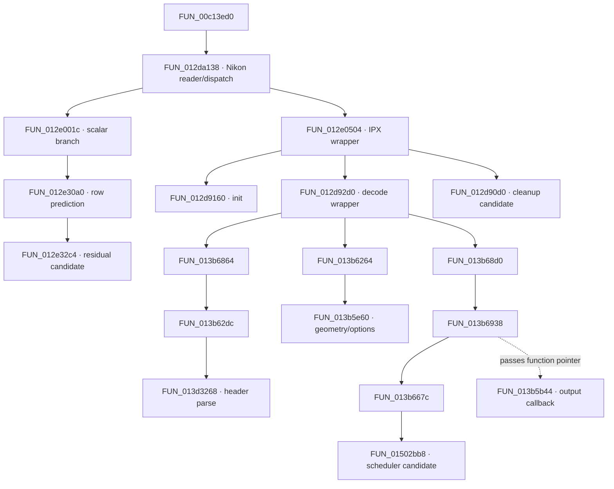

# Nikon HE* / TicoRAW 解码研究：第一阶段

日期：2026-10-12。目标：研究 Z6 III 高效* NEF 的压缩解码，确定 Imprint 解码层的接入边界。本阶段没有研究颜色渲染、去马赛克算法或 GPU 管线，没有修改 Adobe 文件、Ghidra 函数名称/注释/类型或 Imprint 生产代码。

## 当前结果

已有 Ghidra 工程可通过 `ghidra-project` MCP 正常查询，仍有 **75,502 个函数**。已确认 Nikon 读取函数同时具有传统 scalar 和 IPX codec 两条分支；已追踪 IPX 包装层至码流头解析、几何配置、解码任务提交和输出回调地址。

实图 `test_images/LCR_3520.NEF` 的 HE* 主 RAW 数据段与 IPX 头解析器检查的 magic、厂商标识、尺寸布局相匹配。这比仅搜索到字符串更强，但尚未通过运行 ACR 证明该照片实际走过这些函数，也尚未实现熵解码、重建或产生 CFA 输出。

Imprint 当前环境读取此照片失败，因此缺口确实在 RAW 解码入口，不能通过改色彩参数或前端补齐。

## 工程与索引验证

| 项目 | 本次实测 |
|---|---|
| 工程 | `/Users/hualaiwu/Documents/GhidraProjects/CameraRaw-17.2-arm64` |
| MCP program | `/Camera_Raw_arm64.analysis-383152` |
| 函数 / 指令 | 75,502 / 7,351,785 |
| 架构 | `AARCH64:LE:64:AppleSilicon`，小端、64-bit |
| Ghidra | 工程 metadata：12.1.4 |
| 分析状态 | `analysis_complete=true`，metadata `Analyzed=true` |
| 索引状态 | 首次及末次检查均为 `code_indexed=false`、`strings_indexed=false` |
| 二进制 SHA256 | `09978d95dfe76b18495fea9550b051a89f4598ab0fd4734d69d22d330496f40a` |

日志明确记录 `Opening existing project` 与 `Skipping full-project analysis on startup; using existing project state.`。未调用 import、REA 或全量分析接口。已有后台索引日志停留在 `Creating new code collection`，本次日志检查未见其完成消息；MCP 不暴露百分比，不能判断剩余时间或仅凭这些信息断言卡死。

读取本机 `pyghidra_mcp/indexing_mixin.py` 可见：后台代码索引会逐函数反编译，再建立 Chroma collection；这与 Ghidra 的初次分析是不同工作。该索引由已有服务启动，本次未重启服务或另行触发索引。函数/地址查询与按需反编译已成功，研究不等待语义搜索索引。

## 实图证据与最小实验

| 字段 | 结果 |
|---|---|
| 相机 | `NIKON Z6_3` |
| Nikon `NEFCompression` | 原始值 14；ExifTool 显示 `High Efficiency*` |
| 主 RAW IFD | `SubIFD1`，6064 × 4040，14-bit |
| TIFF Compression / PhotometricInterpretation | 34713 (`0x8799`) / 32803 (`0x8023`) |
| CFA | ExifTool `2 2 0 1 1 2`，即 2×2 RGGB |
| 黑电平 | Nikon metadata：1008 / 1008 / 1008 / 1008；尚未校验其在解码输出中的用法 |
| 主 RAW strip | 文件偏移 2,477,568，长度 15,311,360 bytes |
| 文件大小 | 17,788,928 bytes，主 strip 正好结束于 EOF |
| 样本 SHA256 | `6c2276300688850beaae7c997f39ad0a8470333f6ffdf3f33876fa658ae0f313` |

必须带 `-G1 -a` 读取 TIFF 元数据：文件还包含 384×256 的 12-bit 小图等 IFD，不能把末个 `StripOffsets=0` 或某个缩略图当成主 RAW。

主 RAW 开头：`ff 10 ff 50 00 22 43 4f 4e 54 41 43 54 5f 49 4e 54 4f 50 49 58 5f ...`。`0x0022` 是头段长度候选；+6 处是 `CONTACT_INTOPIX_`，+38 处为 `ff12`。尺寸位于该解析器的固定头字段，读出 6064×4040。

本机 `/Users/hualaiwu/.conda/envs/py311/bin/python`，rawpy **0.27.0** / LibRaw **0.22.1**，直接执行 `rawpy.imread` 返回 `LibRawFileUnsupportedError: Unsupported file format or not RAW file`（约 0.004 秒）。这是针对这张照片和当前构建的结果，不能扩大为所有 LibRaw 发行版均不支持。

intoPIX 官方产品页将 Nikon Z6 III 列为 TicoRAW 应用相机，并介绍 RAW Bayer CFA 压缩：[官方说明](https://www.intopix.com/tico-raw)。该来源用于确认产品技术背景；本样本与 ACR 具体实现的关联仍使用本机字节和函数证据。

## 引用类型与已建立调用关系

| 源 → 目标 | 类型 / 证据 | 能证明什么 |
|---|---|---|
| `012dd7a8` → 字符串 `079b21b1` | MCP `PARAM`，`ADRP+ADD` | 标签作为参数构造，不是函数调用 |
| `012dd7b8` → `FUN_00dd5b68` | 汇编 `BL` | 真正调用标签相关 helper；其计时/诊断角色仍属推测 |
| `012dd7dc` → `FUN_012e001c` | MCP `UNCONDITIONAL_CALL` + `BL` | scalar 分支真实调用 |
| `00c141f4` → `FUN_012da138` | MCP `UNCONDITIONAL_CALL` | 上层调用者为 `FUN_00c13ed0`，尚未展开 |
| `085b2aab` → `FUN_012da138` | MCP `DATA` | 非调用；来源数据区具体用途未验证 |
| `012dd834` → `FUN_012e0504` | MCP `UNCONDITIONAL_CALL` + `BL` | 与 scalar 不同的 IPX 分支调用 |
| `012e055c` → `FUN_012d9160` | MCP `UNCONDITIONAL_CALL` | IPX 上下文初始化 |
| `012d91a4` → `FUN_013b5ba0` | MCP `UNCONDITIONAL_CALL` | 初始化 decoder 的调用，错误标签提供角色线索 |
| `FUN_013b6938` → `FUN_013b5b44` | 作为 `FUN_013b667c` 的参数传入 | 回调地址传递；不可伪装成直接调用边 |

实线表示本次反编译或 xref/汇编确认的直接调用；虚线仅表示函数地址作为数据传递，回调的间接执行点尚未恢复。

## 分段分析结论

### Nikon reader / dispatch：`FUN_012da138`

本次反编译长度 95,612 字符，只分析入口字段检查与解码分派片段，未一次输出全文。入口检查包括 IFD photometric 候选 `0x8023`、压缩 `0x8799` 和 12/14-bit 条件，并写入 `image/x-nikon-nef`；其广泛元数据处理不属于本阶段算法研究范围。

`iVar4` 从共享对象 +`0x14a8` 读取。相邻 IPX 分派条件为 unsigned `(iVar4 - 13) < 2`，汇编 `sub #0xd; cmp #1; b.hi` 已核对，即值 13 或 14。样本 Nikon 压缩模式值恰为 14，强烈支持该字段对应 `NEFCompression`，但字段写入位置尚未追踪，因此该对应关系暂列为**推测**。

scalar 前置布尔 `bVar20` 会在大型函数内多次更新，不能只看到初始 `Compression==0x8799` 就认为所有 NEF compressed 都会走 scalar。还需分析 Z6 III 的相机分支、最终布尔及 mode 的来源。伪代码把 +`0x14a8` 等结构偏移显示成 Mach-O header/data 标签，把其他对象字段显示成框架字符串加地址；这些是恢复类型不足导致的表现，不能据此推断色彩框架参与解码。

### 传统 scalar：`FUN_012e001c` / `FUN_012e30a0`

初始化 768-byte 表、读取四个 predictor seed，按最多 16 行的块处理；逐行调用 `FUN_012e30a0`，后者按行奇偶选择两个预测初值，将 `FUN_012e32c4` 返回值累加并限制到数值上界，写出 16-bit 样本。由代码可确认预测差分结构；是否为具体 Huffman 表/历史 Nikon 算法尚未分析。该路径未直接调用本次 IPX 包装器，不能当作 HE* 核心解码器。

### IPX 包装层：`FUN_012e0504` / `FUN_012d9160` / `FUN_012d92d0`

`FUN_012e0504` 受一个非零 enable 字节控制，建立上下文、执行解码、调用清理候选；当前反编译对最后输出参数的传递恢复不完整，不能照抄函数原型作 ABI。

初始化函数分别调用 ctx options、thread count、decoder、image geometry、image format config、decode options 相关候选。每次失败的 `ipxcpucodec_* failed` 标签紧随对应调用，证明这些是组件初始化角色，而不是仅因字符串相邻的猜测。image-format 配置使用常量 5，枚举含义未验证；线程配置失败后尝试 1。

解码包装器验证压缩长度为正且不超过流的剩余长度，读入压缩 bytes，解析 geometry，配置格式，取得输出大小，分配输出内存并调用 codec。它限制 width<=10000、height<=7000，并要求输出 bytes 不超过目标矩形面积×2。之后用 `FUN_0127eca8` 把输出块交给目标图像对象。这些行为支持 16-bit mosaic 输出边界，但尚未得到实际像素，未确认样本的 stride、裁剪和 CFA 相位。

### 头解析：`FUN_013b62dc` → `FUN_013d3268`

后者有 48,770 字符且带 type propagation warning，仅分析开头约 3.8k 字符。它在小端机器上比较 `0x10ff`、`0x50ff`，对应码流 bytes `ff10 ff50`，读取 big-endian 16-bit 长度并检查边界。非零扩展区检查两个 64-bit 常量，其小端 bytes 恰为 `CONTACT_INTOPIX_`，并检查后续 `ff12`。

同一片段读取 big-endian width/height，写至 geometry context +8/+12；样本头在相应位置为 `17 b0 0f c8`，即 6064×4040。至少头部布局已与样本对应。`FUN_013d5810` 是 0x1068-byte context 复制/调整辅助函数，**不是**头解析器，不能因邻近调用误命名。

### 任务与输出回调

`FUN_013b6938` 组织输出指针/行步长，并将 `FUN_013b5b44` 地址传入 `FUN_013b667c`，后者提交给 `FUN_01502bb8`。回调检查行索引及容量，返回输出行地址；可见地址计算使用×4，但该值可能属于内部多分量/中间存储布局，不能由此断言最终 CFA 为 32-bit。scheduler、实际 callback invocation、熵解码和逆变换尚未展开。

## Imprint 接入设计边界（方案，未实施）

当前 `_read_raw` 在 `src/image_io.py` 中直接通过 `rawpy.imread` 进入解码与后续处理；同文件的 enhanced DNG source 路径还直接取 `raw.raw_image_visible` 和 RAW metadata。只修普通预览入口会留下导出和增强入口失败。

推荐独立提供 RAW 解码结果：二维连续 `uint16` CFA + 图案、有效区/边距、位深、黑白电平、相机白平衡和必要相机矩阵元数据。识别 Nikon HE/HE* 时使用 NEFCompression、主 RAW IFD、码流 magic 的组合，不按扩展名或相机名字单独分派。其他 RAW 保持现有解码路径。后续需设计两个现有入口共享该能力，不把压缩 codec 写进 Vue/Rust/BurstFilter，也不把 RGB 预览冒充 CFA。

先在 `research/` 完成独立码流实验和数值验证，再决定生产接入；当前没有足够证据实现完整 codec。可评估官方 FastTicoRAW SDK，其 CFA 解码接口、支持 Nikon variant、授权及跨平台打包需另行核对，不能假定当前已具备。研究中不复制/加载 ACR 私有函数作为 Imprint 运行依赖。

## 下一阶段与验收

1. 追踪 mode +0x14a8 的写入者及 Z6 III 最终 `bVar20` / enable 字节，确认样本的实际静态可达路径。
2. 分段恢复 `FUN_013d3268` 的 marker/bit reader、geometry/precision/profile；读样本头建立逐字段对照，区分存储位深和 codec 内部精度。
3. 从 `FUN_01502bb8` 找 task worker 与真实回调间接调用，再追残差、熵编码、重建、输出 layout；每条调用边保留调用指令地址或函数指针来源。
4. 获得解码器后对本样本验证 6064×4040 CFA、数值范围、有限值、stride/CFA phase/裁剪、黑白电平。当前文件自带小图不能作为全尺寸像素真值；如用 Adobe 输出对照，应独立确认其 CFA/LinearRaw 语义和是否改过像素。
5. decoder 输入异常测试覆盖截断头、长度越界、非法 marker、尺寸溢出和取消；测全分辨率解码时间与峰值内存，再进入 Imprint 两个入口与打包验证。未达到此步前不称为已接入。

## 工程标注方案（尚未执行）

可提出 `FUN_012e0504` → `NikonIpxDecodeWrapper_candidate`、`FUN_012d9160` → `IpxDecoderInit_candidate`、`FUN_012d92d0` → `NikonIpxDecodePayload_candidate`、`FUN_013d3268` → `IpxCodestreamHeaderParse_candidate`，注释中保留地址、依据和未验证 ABI。暂不修改 `FUN_012da138` 名称、不设置结构类型/函数原型。任何工程修改须先由用户批准此具体方案；本轮仅在本文记录。

## 可复核产物

- [调用与长度清单](evidence/2026-10-12-nikon-function-manifest.json)：保存本次成功反编译函数的长度、callee、字符串；callee 清单不是运行轨迹。
- [分段伪代码证据](evidence/2026-10-12-nikon-ghidra-excerpts.md)：仅保存选定片段，不保存两个大型函数的全文。
- [只读样本头探测器](../tools/probe_ticoraw_header.py) 与 [样本结果](evidence/lcr3520-ticoraw-header.json)：验证部分头布局和边界，不等于完整格式校验或 RAW 解码。

探测器限定本次 6064×4040、14-bit 样本布局；不能直接推广到所有 HE/HE* 机型。实际验证：Python 语法检查通过；主代理重跑样本所得 JSON 与保存结果一致；10-byte 截断 TIFF、错误 magic、过短 strip、错误 `ff12` 均被拒绝。`git diff --check` 通过。无生产代码变化，未运行颜色/渲染测试或 Lightroom/ACR 实际导入验证。

本阶段已证实工程、函数数量、静态调用边、样本元数据/头布局以及当前读取失败；mode 字段映射、运行可达性、完整 TicoRAW 算法和 Imprint 接入均尚未完成。
